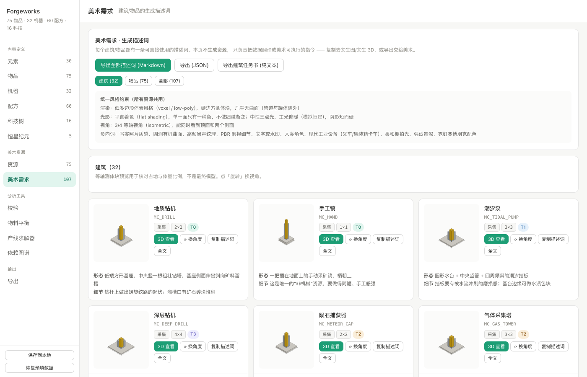
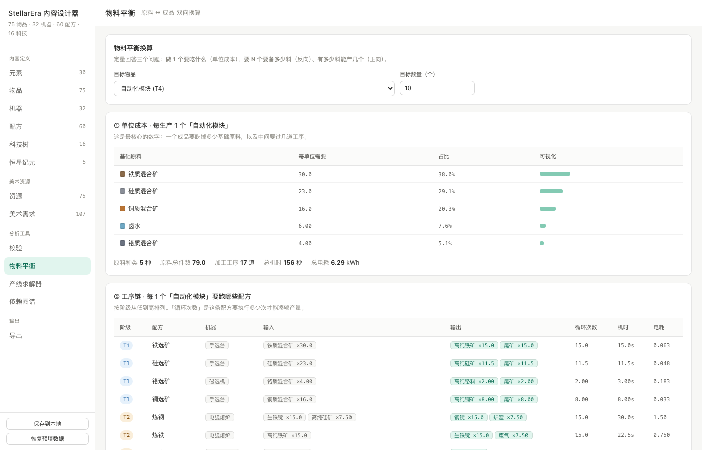
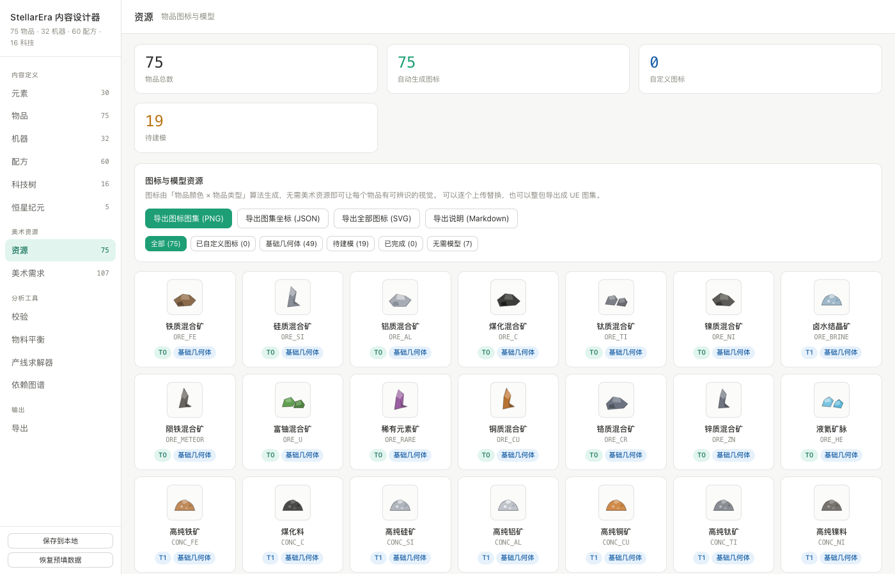
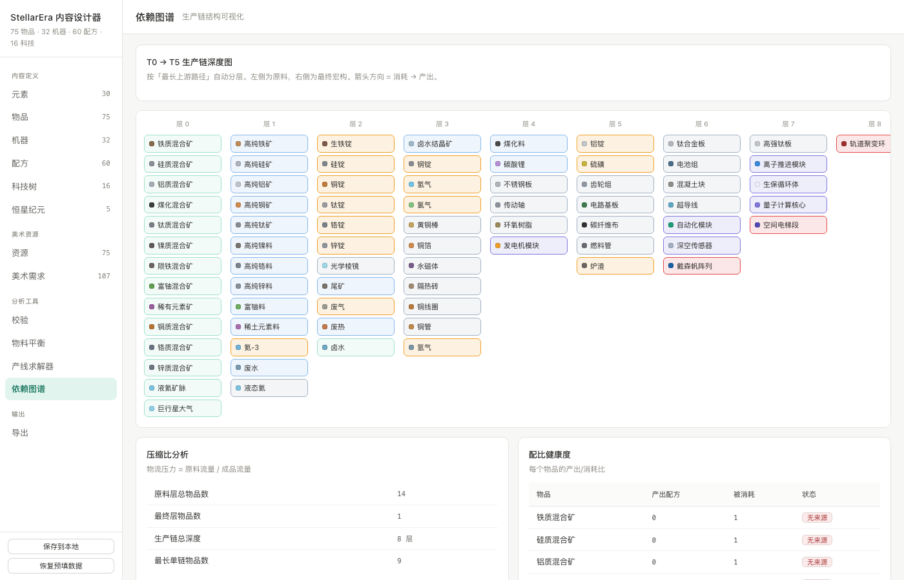
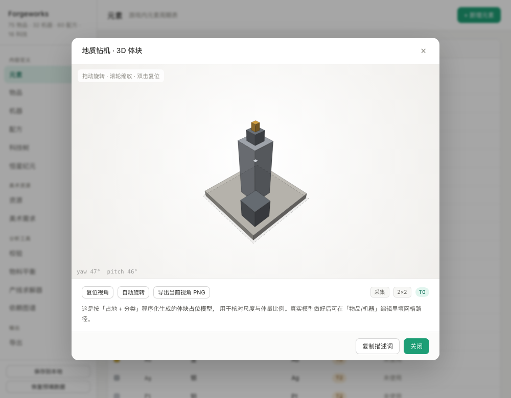

# Forgeworks

**工厂游戏内容设计器** · A content design studio for factory games

定义矿物、配方、机器、科技，实时校验数据完整性，计算物料平衡，生成物品图标与美术需求描述词，
最后导出成 Unreal Engine 的 DataTable。

> 纯前端、零依赖、离线可用。双击 `index.html` 就能跑，不需要 npm install，不需要起服务器。



---

## 它解决什么问题

做工厂类游戏时，真正难的不是"造东西"，而是**让内容自洽且可推理**：

- 改了配方数值，怎么知道下游产线会不会崩？
- 加了新矿种，有没有哪条链断掉了？
- 做一件成品到底要吃多少原料？
- 75 个物品的图标和建模需求怎么统一管理？

这些在 Excel 或文档里改，既容易出错又无法验证。Forgeworks 把它们变成可编辑、可校验、可计算的结构化数据。

---

## 功能

| 模块 | 说明 |
|---|---|
| **内容编辑** | 元素 / 物品 / 机器 / 配方 / 科技 / 纪元，六类数据的增删改 |
| **校验引擎** | 三级严重度检查：悬空引用、循环依赖、内容不可达、副产物无去向、能耗异常 |
| **物料平衡** | 单位成本（做 1 个吃什么）、反向换算（要 N 个要备多少料）、正向换算（有多少料能产几个） |
| **产线求解器** | 目标物品 → 完整生产链，计算每级机器数与总耗电 |
| **依赖图谱** | 按最长上游路径自动分层，看生产链深度与孤立物品 |
| **图标生成** | 按「颜色 × 类型」算法生成 SVG 图标，可导出图集 PNG + 坐标 JSON |
| **美术需求** | 每个建筑/物品的生成描述词，带等轴测体块预览，可导出 Markdown / JSON / 纯文本任务书 |
| **3D 体块查看** | 拖拽 360° 自由环绕、滚轮缩放，可导出当前视角 PNG |
| **导出** | JSON（完整数据）、UE DataTable CSV × 5、Markdown 速查表 |

### 物料平衡

算清「做 1 个成品吃什么」「要 N 个要备多少料」「有多少料能产几个」。



### 图标与美术资源

图标由「颜色 × 类型」算法生成，75 个物品全部有图，可导出图集给 UE。



### 依赖图谱

按最长上游路径自动分层，一眼看出生产链深度和孤立物品。



### 3D 体块查看

点任意建筑的「3D 查看」，可 360° 拖动环绕、滚轮缩放、双击复位。



体块是按「占地 + 分类」程序化生成的占位模型，用来核对尺度与体量比例——
不是最终美术资源。真实模型做好后，在机器编辑里填 `mesh` 路径即可。

---

## 快速开始

```bash
git clone https://github.com/xiaobaibaix/Forgeworks.git
cd Forgeworks
open index.html          # macOS
# start index.html       # Windows
```

浏览器打开即用。数据存在 localStorage，`Cmd/Ctrl + S` 保存。

---

## 目录结构

```
Forgeworks/
├── index.html              入口（脚本按依赖顺序加载）
├── css/
│   ├── theme.css           变量、重置、排版
│   ├── layout.css          三栏骨架
│   └── components.css      表格、卡片、弹窗、表单
└── js/
    ├── core/
    │   ├── config.js       常量（存储键名）
    │   ├── state.js        状态、localStorage、资源字段补全
    │   ├── lookup.js       索引查询
    │   └── io.js           下载、剪贴板
    ├── data/
    │   ├── seed.js         预填数据集（75 物品 / 32 机器 / 60 配方）
    │   └── prompts.js      美术需求描述词库 + 等轴测体块预览
    ├── engines/
    │   ├── icons.js        程序化 SVG 图标
    │   ├── viewer3d.js     Canvas 软件 3D 渲染（体块查看器）
    │   ├── validate.js     校验引擎
    │   ├── solver.js       产线求解
    │   ├── balance.js      物料平衡
    │   └── csv.js          UE DataTable CSV 生成
    ├── ui/
    │   ├── table.js        通用表格
    │   ├── router.js       视图路由（VIEWS 延迟构建）
    │   └── editor.js       编辑弹窗
    ├── views/              13 个视图，每个一个文件
    └── main.js             启动
```

### 为什么不用 ES Module

`import` 在 `file://` 协议下会被 CORS 拦截，双击打不开。所以全部用普通 `<script>` +
全局作用域，靠 `index.html` 里的加载顺序保证依赖。

**加载顺序不能乱**：`data/seed.js` 必须在 `core/state.js` 之前，因为后者初始化时要读 `SEED`。
同理 `ui/router.js` 里的 `VIEWS` 用 `makeViews()` 延迟构建——它要比所有 `views/*.js` 先加载，
不能在顶层直接引用还没定义的渲染函数。

---

## 数据格式

物品定义：

```js
{
  id: 'ORE_FE',
  name: '铁质混合矿',
  tier: 0,                    // T0~T5 资源阶梯
  type: 'raw',                // raw/concentrate/ingot/part/material/module/mega/byproduct/fluid
  color: '#8b6b4a',           // 图标会自动用这个颜色
  value: 1,
  desc: 'Fe 55~65%',
  icon: '',                   // 空 = 用算法生成图标
  visual: '',                 // 图标形态覆盖（如 type=raw 但视觉是 fluid）
  mesh: '',                   // UE 静态网格路径
  mat: '',                    // 材质路径
  modelStatus: 'primitive'    // none / primitive / needed / done
}
```

配方定义：

```js
{
  id: 'R_SMT_STEEL', name: '炼钢', machine: 'MC_ARC', cat: '冶炼',
  cycle: 2.0,                 // 周期（秒）
  power: 180,                 // 耗电 kW
  tier: 2, unlock: 'E0',
  inputs:  [{ item: 'ING_PIG', amount: 1 }, { item: 'CONC_SI', amount: 0.5 }],
  outputs: [{ item: 'ING_STEEL', amount: 1 }, { item: 'WASTE_SLAG', amount: 0.5 }]
}
```

---

## 物料平衡的算法

核心是追踪**毛需求**与**毛产出**，两者之差即净需求：

```
净需求 = 总消耗 - 总产出
```

- 净需求 > 0 且是原料 → 必须从外部投入
- 净需求 < 0 → 副产物盈余

**关键语义**：`type === 'raw'` 的物品是**硬性叶子节点**，即使它有回收配方也不会被展开。
理由：原料本质来自地质采集，回收只是补充手段，不改变"需要外部投入"这个事实。

正向换算则是取所有原料的短板：

```
最大产量 = min(库存ᵢ / 单位成本ᵢ)
```

实测精度：库存 = 单位成本 × 100 时，算出产量精确为 100；某原料降到 1/4 时精确为 25。

---

## 图标生成

不依赖美术资源，按「物品颜色 × 物品类型」用 SVG 绘制：

| 类型 | 形态 |
|---|---|
| raw | 4 套矿石轮廓 + 逐块 ±2px 扰动 |
| concentrate | 料堆 + 颗粒 |
| ingot | 梯形锭 + 顶面高光 |
| part | 齿轮 |
| material | 堆叠板材 |
| module | 电路基板 |
| mega | 环形轨道结构 |
| byproduct | 碎石堆 |
| fluid | 液滴 |

75 个物品 → 22 种几何形状，其余靠颜色区分。

导出：**图集 PNG**（8 列网格）+ **坐标 JSON**（每格 UV）→ UE 里一张贴图搞定所有图标。

### 3D 查看器为什么不用 three.js

1. 本项目承诺**零依赖、离线可用**，引入 600KB 的库会破坏这个前提
2. 当前模型就是程序化的方块堆，不需要 PBR / 骨骼 / 蒙皮
3. 自己写只要约 300 行，还能完全控制拖动手感

实现是标准的软件光栅化流程：

```
盒子 → 旋转（yaw/pitch）→ 透视投影 → 几何法线剔除背面
     → 画家算法按深度排序 → 平面着色 → 描边
```

**这里踩过一个坑**：面的顶点绕序必须统一按「从外部看逆时针」排列，
否则法线朝内，背面剔除会把该显示的面剔掉——模型看起来像纸片、能看穿。
`tests/smoke.html` 里有一条专门的检查（「3D 面绕序」）盯着这件事。

---

## 导出到 Unreal Engine

1. 定义 C++ 结构体（见 `docs/ue-import.md`）
2. 「导出」页下载 JSON → 放到 `<项目>/Content/Data/StellarEra_Content.json`
3. 运行 `tools/import_datatables.py`（UE Python 控制台）

```python
exec(open(r"D:/Projects/StellarEra/Tools/import_datatables.py").read())
import_all()
```

生成 5 张表：`DT_ItemDef` / `DT_MachineDef` / `DT_RecipeDef` / `DT_TechDef` / `DT_ElementDef`。

> 图标不进 CSV，走图集方案。

---

## 已知限制

- 求解器不处理配方分支的组合爆炸，副产物去向需人工核对
- 不做多配方并行生产（只给一条链）
- 元素暂时不参与配方计算，仅作展示
- 本地存储上限约 5MB；数据量大时用 JSON 导入导出

## 测试

用真实浏览器跑冒烟测试（不需要 npm）：

```bash
bash tests/run.sh
```

它会用 Chrome/Edge headless 打开 `tests/smoke.html`，检查 25 项：

- 数据加载、VIEWS 构建
- 所有视图逐个渲染不报错
- 32 个建筑 + 75 个物品的描述词全部能生成
- 32 个建筑体块预览全部能渲染
- 3D 体块构建、面绕序正确、渲染器可创建并导出 PNG
- 75 个物品图标全部能生成
- 物料平衡、CSV、Markdown 导出正常

输出示例：

```json
{ "summary": { "total": 25, "pass": 25, "fail": 0, "runtimeErrors": 0 } }
```

## 浏览器兼容

Chrome / Edge / Safari / Firefox 近期版本。无构建步骤，无第三方依赖。

## License

MIT
