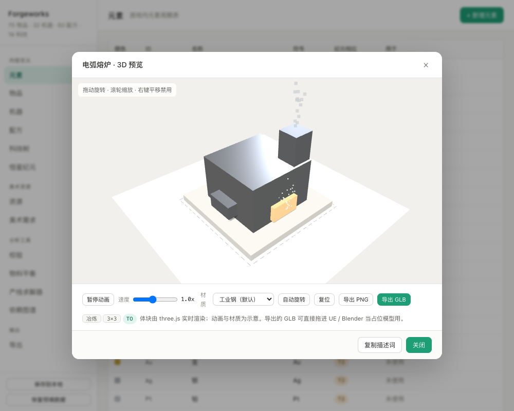

# Forgeworks

**工厂游戏内容设计器** · A content design studio for factory games

定义矿物、配方、机器、科技，实时校验数据完整性，计算物料平衡，生成物品图标与美术需求描述词，
用 three.js 预览 3D 体块并导出 GLB，最后导出成 Unreal Engine 的 DataTable。

> 纯前端、零构建、离线可用。双击 `index.html` 就能跑，不需要 npm install，不需要起服务器。

---

## 它解决什么问题

做工厂类游戏时，真正难的不是"造东西"，而是**让内容自洽且可推理**：

- 改了配方数值，怎么知道下游产线会不会崩？
- 加了新矿种，有没有哪条链断掉了？
- 做一件成品到底要吃多少原料？
- 75 个物品的图标和建模需求怎么统一管理？
- 建筑长什么样、多大、怎么动，怎么跟美术对齐？

这些在 Excel 或文档里改，既容易出错又无法验证。Forgeworks 把它们变成可编辑、可校验、可计算的结构化数据。

---

## 功能

| 模块 | 说明 |
|---|---|
| **内容编辑** | 元素 / 物品 / 机器 / 配方 / 科技 / 纪元，六类数据的增删改 |
| **风格引擎** | 单一风格基线 + 旋钮微调，描述词/图标/3D 预览/GLB 元数据共用一套色板，内置一致性检查 |
| **校验引擎** | 三级严重度：悬空引用、循环依赖、内容不可达、副产物无去向、能耗异常 |
| **物料平衡** | 单位成本、反向换算（要 N 个要备多少料）、正向换算（有多少料能产几个） |
| **产线求解器** | 目标物品 → 完整生产链，计算每级机器数与总耗电 |
| **依赖图谱** | 按最长上游路径自动分层，看生产链深度与孤立物品 |
| **图标生成** | 按「颜色 × 类型」算法生成 SVG 图标，可导出图集 PNG + 坐标 JSON |
| **3D 预览** | three.js 实时渲染：轨道拖动、实时阴影、材质预设、程序化动画、粒子、GLB 导出 |
| **导出** | JSON（完整数据）、UE DataTable CSV × 5、Markdown 速查表 |

### 风格引擎

生成类美术最容易翻车的不是单个模型质量，而是**成套感**——每个模型单看不错，
摆在一起却像六个项目拼的。根因通常是配色逐个手写，彼此不在同一个饱和度/明度带。

风格引擎的解法是让程序强制统一：

> **色相负责区分功能，饱和度/明度负责统一风格。**

- 内置唯一一套面向 StellarEra 题材的风格基线（体素工业）
- 定义 8 个「角色带」（结构 / 金属 / 强调 / 发光…），大面积结构低饱和、小面积强调色可以艳
- 任何颜色经过 `fitColor()` 都会被校正进角色带——色相保留（冶炼还是橙色），明度饱和度统一
- 描述词、图标、3D 预览、GLB 元数据**全部从同一处取色**，所见即所得
- 一致性检查扫描全部数据，把偏离量量化出来；建筑配色还能一键生成修正代码
- 6 个旋钮（饱和度 / 对比 / 磨损 / 金属感 / 发光 / 细节密度）可覆盖基线默认值，存 localStorage 不污染内容数据

### 设计中：资产流水线与 UE 同步（待评审）

两份设计计划书已完成，待确认后实施：

- **`docs/pipeline-design.md`** — 资产生成流水线（节点图）：描述词 → 三视图 → 图生3D → 减面 → 风格对齐 → 手动编辑 → 导出。接入大模型（Tripo multiview 端点链 / Meshy / 火山方舟 / 智谱），Bridge 统一代理密钥，差量执行控制成本（改风格只重跑受影响节点，不重复花钱）
- **`docs/sync-design.md`** — UE 项目双向同步：绑定项目目录、按机器分目录导出（GLB/贴图/图标/清单）、manifest 状态机、UE 侧 Python 自动导入与回写、3D 视图精细化（层级/gizmo/局部全局坐标）。Blender 后台模式已实测可用（0.15s 导入校验，6s 渲染缩略图）

两篇共用「本地 Bridge 服务」地基（`serve.py` 升级），且实测结论全部写入文档：
浏览器无法生成 .uasset（硬限制，中间格式 + UE 侧脚本导入）；glTF 米 vs UE 厘米的
100 倍单位陷阱；UE 5.8.3 自动导入不再自动保存的坑；实测三角面超预算约 3 倍需质量门禁。

### 物料平衡

算清「做 1 个成品吃什么」「要 N 个要备多少料」「有多少料能产几个」。


### 图标与美术资源

图标由「颜色 × 类型」算法生成，75 个物品全部有图，可导出图集给 UE。


### 依赖图谱

按最长上游路径自动分层，一眼看出生产链深度和孤立物品。


### 3D 体块查看

在「机器」列表里**点击任意一行**，直接弹出该机器的 3D 预览；行尾的「编辑」按钮改参数。

基于 three.js 实时渲染：

- **轨道拖动** 360° 环绕、滚轮缩放、阻尼惯性、双击复位
- **实时阴影** + 环境反射（RoomEnvironment 生成 PMREM）
- **材质系统**：metalness / roughness / emissive / 透明
- **材质预设**：工业钢 / 锈蚀 / 洁净实验室 / 陶瓷装甲 / 深空合金，一键切换
- **程序化动画**：转动、摆动、平移、上下浮动、自发光脉动
- **粒子效果**：火星、烟雾、气泡、碎屑，按建筑类型自动匹配
- **播放控制**：暂停 / 速度 0.25x~2x
- **导出**：当前视角 PNG、**GLB 模型**（单网格 + N 材质槽，为 UE 优化）


冶炼类建筑会表现熔炼过程：炉门自发光脉动 + 火星上飘 + 烟囱冒烟。



模型按「占地 + 分类」程序化生成，**由 8 种几何图元组合而成**，不是方块堆：

| 图元 | 用途 | 实例 |
|---|---|---|
| `box` | 基座、机架、控制柜 | 混凝土台、龙门横梁 |
| `cyl` | 罐体、烟囱、立柱、主轴 | 高炉炉身、储罐、压机立柱 |
| `cone` | 料斗、集尘罩、钻头（可设上下半径 = 圆台） | 料斗、炉喉、锥形烟囱帽 |
| `sphere` | 球形储罐、指示器 | 化工球罐、警示灯 |
| `dome` | 半球封头 | 罐顶封头 |
| `torus` | 法兰、加强箍、环形风管、检修平台 | 高炉风口环、罐体法兰 |
| `pipe` | 两点之间的管道（自动算朝向与长度） | 罐间连通管、液压管路 |
| `prism` | 棱柱（n 边） | 八角形厂房、四棱锥屋顶 |

当前数据实测：**9 种图元、187 个圆柱**，非方块部件在每个建筑中占比都超过 1/3。

真实资产做好后，在机器编辑里填 `mesh` 路径即可。

### 为什么用 three.js（但本地 vendor）

一开始写了个 Canvas 2D 软件渲染器，零依赖、约 300 行就能跑。
后来换成 three.js —— 后续需求（真实模型加载、GLTF 导入导出、法线贴图、多光源、后处理）
自研渲染器撑不住。

但**不用 CDN**，three r147 的 UMD 构建和扩展放在 `js/vendor/`（约 870KB）：

| 文件 | 用途 |
|---|---|
| `three.min.js` | 核心（r147，UMD，挂 `window.THREE`） |
| `OrbitControls.js` | 轨道控制（阻尼、缩放、角度限制） |
| `RoomEnvironment.js` | 生成环境贴图，金属材质才有反射 |
| `GLTFExporter.js` | 导出 GLB |
| `GLTFLoader.js` | 预留：加载外部模型 |

所以**依然离线可用**，双击就行。需要浏览器支持 WebGL，不支持时会弹提示而不是白屏。

---

## 快速开始

```bash
git clone https://github.com/xiaobaibaix/Forgeworks.git
cd Forgeworks
open index.html          # macOS
# start index.html       # Windows
```

浏览器打开即用。数据存在 localStorage，`Cmd/Ctrl + S` 保存。

**开发时建议用自带的静态服务器**（禁用缓存）：

```bash
python3 tools/serve.py        # http://127.0.0.1:8787
```

> 别用 `python3 -m http.server` —— 它不发送 `Cache-Control`，浏览器会缓存 JS，
> 改完代码刷新页面跑的仍是旧版本，很难排查。侧栏底部有版本戳可以确认。

**改完 JS/CSS 后打一次版本戳**（把所有 `?v=` 查询串统一刷新，绕过浏览器缓存）：

```bash
python3 tools/stamp.py        # 自动生成：20261021c -> 20261021d
python3 tools/stamp.py --show # 只看当前版本号
```

脚本会改写 `index.html` 和 `tests/smoke.html` 里的 37 处资源引用，
同一天多次打戳自动递进字母序号。界面左下角的版本戳是**运行时从 `main.js`
自己的 `src` 里读出来的**，所以打完戳会自动跟上，不用改第二处。

打开时把版本号带上最保险：

```
http://127.0.0.1:8787/index.html?v=20261021d
```

支持的 URL hash：`#balance` `#assets` `#graph` 等，可直接打开指定视图。

---

## 目录结构

```
Forgeworks/
├── index.html              入口（脚本按依赖顺序加载）
├── css/
│   ├── theme.css           变量、重置、排版
│   ├── layout.css          三栏骨架
│   └── components.css      表格、卡片、弹窗、表单
└── js/
    ├── vendor/             第三方（本地 vendored，离线可用）
    │   ├── three.min.js        three r147 UMD
    │   ├── OrbitControls.js    轨道控制
    │   ├── RoomEnvironment.js  环境贴图
    │   ├── GLTFExporter.js     导出 GLB
    │   └── GLTFLoader.js       预留：加载模型
    ├── core/
    │   ├── config.js       常量（存储键名）
    │   ├── color.js        颜色工具（hexToHsl / clampSL / mixHex，全局唯一定义）
    │   ├── state.js        状态、localStorage、资源字段补全
    │   ├── style.js        风格引擎：角色带校正、一致性检查、修正表
    │   ├── lookup.js       索引查询
    │   └── io.js           下载、剪贴板
    ├── data/
    │   ├── styles.js       风格基线 + 角色带定义 + 旋钮定义
    │   ├── seed.js         预填数据集（75 物品 / 32 机器 / 60 配方）
    │   └── prompts.js      美术需求描述词库 + 等轴测体块预览
    ├── engines/
    │   ├── icons.js        程序化 SVG 图标（配色走风格引擎）
    │   ├── viewer3d.js     three.js 3D 查看器 + 体块构建 + 粒子
    │   ├── validate.js     校验引擎
    │   ├── solver.js       产线求解
    │   ├── balance.js      物料平衡
    │   └── csv.js          UE DataTable CSV 生成
    ├── ui/
    │   ├── table.js        通用表格
    │   ├── router.js       视图路由（VIEWS 延迟构建）
    │   └── editor.js       编辑弹窗
    ├── views/              14 个视图，每个一个文件（style.js 是风格控制面板）
    └── main.js             启动
├── tools/
│   ├── serve.py            静态服务器（发 no-store，禁用缓存）
│   ├── stamp.py            版本戳打戳（统一刷新 ?v= 查询串）
│   ├── import_datatables.py  UE Python 导入脚本
│   └── DT_*.csv            导出的 DataTable 样例
├── tests/
│   ├── smoke.html          真实浏览器自测页（47 项检查，含 15 项风格链路）
│   └── run.sh              冒烟测试入口
└── docs/
    ├── ue-import.md        UE 导入指南
    ├── sample-content.json 内容样例
    └── screenshots/        效果截图
```

### 加载顺序很重要

全部是普通 `<script>`（不是 ES module）——`import` 在 `file://` 下会被 CORS 拦截，双击打不开。
靠 `index.html` 里的顺序保证依赖，顺序错了直接白屏：

1. `data/seed.js` 必须在 `core/state.js` 之前（后者初始化时要读 `SEED`）
2. `core/color.js` 必须在 `engines/icons.js` 之前（图标引擎要用它做 HSL 变换，
   颜色工具全局只有这一份定义，多份实现会导致颜色对不上）
3. `data/styles.js` 必须在 `core/style.js` 之前（风格引擎读基线）；
   `core/style.js` 必须在 `engines/*` 之前（图标与 3D 都要跟风格联动）
4. `js/vendor/three.min.js` 必须在 `engines/viewer3d.js` 之前
5. `ui/router.js` 里的 `VIEWS` 用 `makeViews()` 延迟构建，它比所有 `views/*.js` 先加载，
   不能在顶层直接引用还没定义的渲染函数

> 风格相关的函数（`getStyle` / `fitColor` / `accentFor`）虽然定义在 `core/style.js`，
> 但 `data/prompts.js` 等更早加载的文件也可以在**函数体内**调用它们——
> 只要不在顶层立即执行，运行时定义早已就位。这是本仓库加载顺序的核心约定。

---

## 数据格式

物品定义：

```js
{
  id: 'ORE_FE',
  name: '铁质混合矿',
  tier: 0,                    // T0~T5 资源阶梯
  type: 'raw',                // raw/concentrate/ingot/part/material/module/mega/byproduct/fluid
  color: '#8b6b4a',           // 图标会自动用这个颜色
  value: 1,
  desc: 'Fe 55~65%',
  icon: '',                   // 空 = 用算法生成图标
  visual: '',                 // 图标形态覆盖（如 type=raw 但视觉是 fluid）
  mesh: '',                   // UE 静态网格路径
  mat: '',                    // 材质路径
  modelStatus: 'primitive'    // none / primitive / needed / done
}
```

配方定义：

```js
{
  id: 'R_SMT_STEEL', name: '炼钢', machine: 'MC_ARC', cat: '冶炼',
  cycle: 2.0,                 // 周期（秒）
  power: 180,                 // 耗电 kW
  tier: 2, unlock: 'E0',
  inputs:  [{ item: 'ING_PIG', amount: 1 }, { item: 'CONC_SI', amount: 0.5 }],
  outputs: [{ item: 'ING_STEEL', amount: 1 }, { item: 'WASTE_SLAG', amount: 0.5 }]
}
```

---

## 物料平衡的算法

核心是追踪**毛需求**与**毛产出**，两者之差即净需求：

```
净需求 = 总消耗 - 总产出
```

- 净需求 > 0 且是原料 → 必须从外部投入
- 净需求 < 0 → 副产物盈余

**关键语义**：`type === 'raw'` 的物品是**硬性叶子节点**，即使它有回收配方也不会被展开。
理由：原料本质来自地质采集，回收只是补充手段，不改变"需要外部投入"这个事实。

正向换算取所有原料的短板：

```
最大产量 = min(库存ᵢ / 单位成本ᵢ)
```

实测精度：库存 = 单位成本 × 100 时，算出产量精确为 100；某原料降到 1/4 时精确为 25。

---

## 图标生成

不依赖美术资源，按「物品颜色 × 物品类型」用 SVG 绘制：

| 类型 | 形态 |
|---|---|
| raw | 4 套矿石轮廓 + 逐块 ±2px 扰动 |
| concentrate | 料堆 + 颗粒 |
| ingot | 梯形锭 + 顶面高光 |
| part | 齿轮 |
| material | 堆叠板材 |
| module | 电路基板 |
| mega | 环形轨道结构 |
| byproduct | 碎石堆 |
| fluid | 液滴 |

75 个物品 → 22 种几何形状，其余靠颜色区分。

导出：**图集 PNG**（8 列网格）+ **坐标 JSON**（每格 UV）→ UE 里一张贴图搞定所有图标。

---

## 导出到 Unreal Engine

1. 定义 C++ 结构体（见 [docs/ue-import.md](docs/ue-import.md)）
2. 「导出」页下载 JSON → 放到 `<项目>/Content/Data/StellarEra_Content.json`
3. 运行 `tools/import_datatables.py`（UE Python 控制台）

```python
exec(open(r"D:/Projects/StellarEra/Tools/import_datatables.py").read())
import_all()
```

生成 5 张表：`DT_ItemDef` / `DT_MachineDef` / `DT_RecipeDef` / `DT_TechDef` / `DT_ElementDef`。

> 图标不进 CSV，走图集方案。

### 3D 体块 → UE

在 3D 预览弹窗点「导出 GLB」，得到的是**为 UE 优化过**的模型：

- 按材质合并成 **1 个静态网格 + N 个材质槽**（否则 30 个部件会变成 30 个资产）
- 材质槽命名 `M_body` / `M_glow`，节点名 = 机器 ID
- 严格缩放到声明占地内（3×3 就是 3×3 米），底部对齐 y=0
- 动画参数写进 glTF `extras`，UE 侧可读

**能保证**：网格结构、尺寸、轴心、朝向、PBR 参数、碰撞（导入时勾选）。

**不能保证**：动画（GLB 是静态的）、自发光强度 >1（glTF 规范限制）、
贴图/法线、LOD、UV。详见 [docs/ue-import.md](docs/ue-import.md)。

> 这套模型的定位是 **blockout 占位模型**：在美术进场前验证体积、间距、
> 动画逻辑与朝向。真实模型做好后，把机器数据里的 `mesh` 字段指向真模型即可。

---

## 测试

用真实浏览器跑冒烟测试（不需要 npm）：

```bash
bash tests/run.sh
```

它用 Chrome/Edge headless 打开 `tests/smoke.html`，检查 32 项：

- 数据加载、VIEWS 构建、13 个视图逐个渲染不报错
- 机器列表 32 行点击均可打开 3D、每行都有 3D/编辑按钮
- 32 个建筑 + 75 个物品的描述词全部能生成
- 32 个建筑体块构建、82 个动画部件合法、32 个建筑带粒子配置
- 几何体类型多样（非方块图元 ≥5 种，每个建筑非方块占比 ≥1/3）
- three.js / OrbitControls / GLTFExporter 加载正常
- 3D 渲染器可创建并渲染、GLB 结构与占地约束正确
- 75 个物品图标全部能生成
- 物料平衡、CSV、Markdown 导出正常

输出：

```json
{ "summary": { "total": 32, "pass": 32, "fail": 0, "runtimeErrors": 0 } }
```

> headless 下 WebGL 需要 SwiftShader 软件渲染，`run.sh` 已经带上
> `--use-gl=swiftshader --enable-unsafe-swiftshader` 参数。

---

## 已知限制

- 求解器不处理配方分支的组合爆炸，副产物去向需人工核对
- 不做多配方并行生产（只给一条链）
- 元素暂时不参与配方计算，仅作展示
- 本地存储上限约 5MB；数据量大时用 JSON 导入导出
- 3D 预览需要 WebGL 支持
- 体块是程序化占位，不是最终美术资产

## 浏览器兼容

Chrome / Edge / Safari / Firefox 近期版本。无构建步骤。

第三方库：three.js r147（MIT），本地 vendored。

## License

MIT
